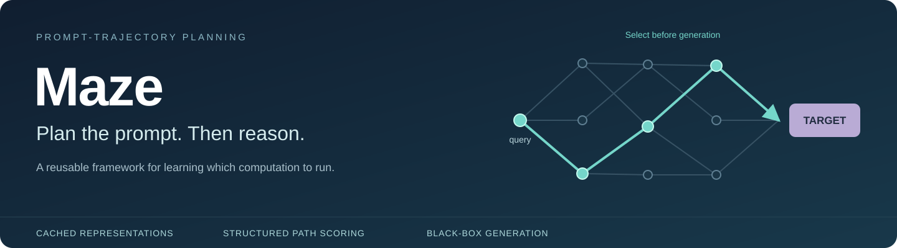
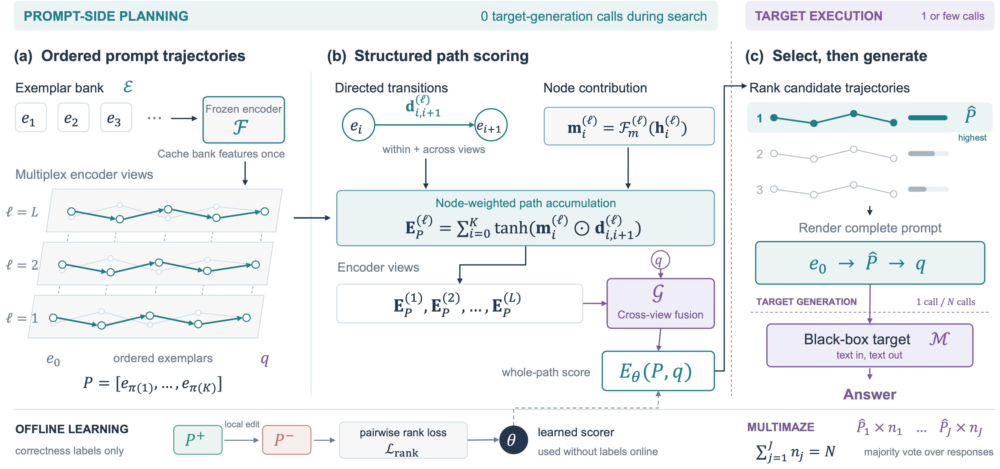

<div align="center">
  
  <p>
    <a href="https://openreview.net/forum?id=e22Krci8Dn"></a>
    <a href="pyproject.toml"></a>
    <a href="LICENSE"></a>
    <a href="CHANGELOG.md"></a>
  </p>
  <p><a href="#the-idea">The idea</a> · <a href="#measured-results">Results</a> · <a href="#start-here">Get started</a> · <a href="docs/USAGE.md">Run Maze</a> · <a href="docs/DEVELOPMENT.md">Build on Maze</a> · <a href="#citation">Cite</a></p>
</div>

**Maze learns which prompt trajectory to execute before asking a language model to reason.**
It ranks complete, ordered exemplar sequences using cached encoder representations and a small geometric scorer, then spends target-model calls on the selected prompts.
The target remains a text-in, text-out model: no target weights, gradients, or hidden states are required.

This is the home of the **Maze project**, spanning the NeurIPS 2026 method, compact scorer variants, inference policies, and reusable experimentation tools.
The library, experiment configurations, and result records are separated so that new models and applications can be added without changing existing experiments.

## The idea

<p align="center"></p>

A prompt is more than an unordered set of relevant examples.
Its content, order, and relation to the query jointly determine the computation it elicits.
Maze makes that ordered path the object of learning:

$$
\widehat P=\arg\max_{P\in\mathcal P(q)}E_\theta(P,q).
$$

The scorer combines **directed transitions**, **node contributions**, and **query-conditioned fusion across encoder views**.
It evaluates candidate inputs, not generated answers.
Bank features are cached, each new query is encoded once, and ranking makes no target-generation calls.

Single-call Maze executes the selected trajectory once.
MultiMaze allocates a fixed budget across selected trajectories, with $\sum_{j=1}^{J}n_j=N$.
Independent-pool winners, shared-pool top-$N$ selection, and repeated decoding of one selected prompt are all supported.
See the [method](docs/METHOD.md) and [scorer configurations](configs/scorers/).

## Measured results

**Seven selected comparisons across two development cohorts, with 131 questions and 789 question-by-arm records.**
The following results are reconstructed from the included numeric outcome ledger, not copied from the paper tables.
Every row uses **nonthinking Qwen3.5-4B** with **four complete exemplars**.
Cohort sizes are part of the names: GPQA Diamond99 and MMLU-Pro32 are not the full benchmarks.

| Cohort | Maze policy | Baseline | Maze accuracy | Baseline accuracy | Gain | Calls | Token ratio |
|---|---|---|---:|---:|---:|---:|---:|
| GPQA Diamond99 | Single-call Maze | Random prompt, 1 call | **65.66%** | 62.63% | +3.03 pp | 1 / 1 | 1.058× |
| GPQA Diamond99 | Single-call Maze | Random-path MV2 | **65.66%** | 63.64% | +2.02 pp | 1 / 2 | 0.506× |
| GPQA Diamond99 | MultiMaze, repeated prompt | Random-path MV3 | **71.72%** | 66.67% | +5.05 pp | 3 / 3 | 1.016× |
| GPQA Diamond99 | MultiMaze, repeated prompt | Random-path MV4 | **71.72%** | 69.70% | +2.02 pp | 3 / 4 | 0.762× |
| GPQA Diamond99 | MultiMaze, repeated prompt | Random-path MV8 | **71.72%** | 69.70% | +2.02 pp | 3 / 8 | 0.376× |
| MMLU-Pro32 | MultiMaze, repeated prompt | Retrieval SC3 | **78.12%** | 75.00% | +3.12 pp | 3 / 3 | 0.997× |
| MMLU-Pro32 | MultiMaze, repeated prompt | Random-prompt SC3 | **78.12%** | 65.62% | +12.50 pp | 3 / 3 | 1.105× |


**Reading the table.** Calls are Maze / comparator.
A token ratio below 1 means fewer recorded processed tokens: target input + target output + once-per-query encoder tokens.
This is not an end-to-end latency or total training-cost measurement.
SC3 votes three distinct requests for the same selected prompt; MV$N$ votes separately sampled prompt paths.

These are **selected development-setting comparisons**, not seven independent benchmarks or an exhaustive evaluation.
The [result report](results/reproduced/summary.json) includes exact fractions, paired wins/losses, and descriptive 95% bootstrap intervals.
Intervals are conditional on these cohorts and are not adjusted for configuration selection; positive observed differences are not, by themselves, significance claims.

### Reconstruct the table on CPU

From the repository root, using only Python's standard library:

```bash
python scripts/reproduce_results.py --output runs/reproduced
```

The command verifies the ledger, reconstructs all included arms, and writes JSON, CSV, and Markdown comparisons.
It preserves incorrect, invalid, and truncated outcomes within each included arm.
See the [saved outputs](results/reproduced/) and [experiment definitions](docs/EXPERIMENTS.md).

> **What this reproduces:** the published aggregate accuracy, call counts, token accounting, and paired statistics from saved question-level correctness records.
> It does not independently regrade response text or rerun the original target model.
> Original benchmark feature tensors, trained checkpoints, and raw response archives are not bundled.
> Fresh training and generation use the separate workflows below and require their own data and fitted assets.

## Start here

Use Python 3.11 or newer.
The result command above needs no installation, GPU, API key, or network connection.
For the library and examples:

```bash
python -m venv .venv
source .venv/bin/activate
python -m pip install -e .

# Inspect the workflows and exercise planning, request collection, and grading.
maze --help
maze demo --output runs/demo

# Run the NumPy/reference tests. PyTorch-specific tests need the train extra.
python -m unittest discover -s tests -v
```

The demo uses invented features and a deterministic Python target to illustrate the interfaces; it is not a benchmark experiment.

For differentiable training and numerical checks against the preserved compact scorers:

```bash
python -m pip install -e '.[train]'
maze train-demo --output runs/train-demo
python -m unittest discover -s tests -v
```

The training demo checks gradient updates, checkpoint export, and inference on disjoint synthetic query identities.
[Usage](docs/USAGE.md) covers real data preparation, local-edit supervision, training, prospective planning, API collection, and separate evaluation.

## Method implementations and variants

| Component | What it provides | Entry point |
|---|---|---|
| Scalar-fusion Maze | Directed path energy with coordinate reduction before cross-view nonlinearity | [NumPy](src/maze/scorers/numpy_energy.py), [PyTorch](src/maze/scorers/torch_energy.py), [independent reference](src/maze_paper/scalar_energy.py) |
| Compact vector Maze | Normalized node features, coordinate-preserving fusion, learned scalar readout | [Compact configuration](configs/scorers/compact_vector.json) |
| Full-QA vector Maze | Encoded system and full exemplars, all-view context, interior-view readout | [Full-QA configuration](configs/scorers/fullqa_vector.json) |
| Scorer consensus | Weighted combination of independently fitted input-side energies | [Ensemble](src/maze/scorers/ensemble.py) |
| Residual utility calibration | Query-balanced reference-relative utility fitting | [Calibration](src/maze/calibration.py), [script](scripts/calibrate_residual.py) |
| MultiMaze | Independent pools, top-$N$, repeated prompts, or mixed allocation | [Planner](src/maze/planning.py), [policy configurations](configs/policies/) |
| Archived compact recipes | Original success, reference-relative, auxiliary-loss and replay definitions | [Compact reproduction](reproduction/compact/) |

The generic trainer fits success and ranking objectives.
The preserved compact recipes also expose the auxiliary objectives used by their original configurations.
Implementations are checked for numerical consistency; the measured results above retain their own experiment identities rather than being attributed to every variant.

## A project built to extend

```text
src/maze/                  Reusable planning, scorers, training, and model adapters
src/maze_paper/            Independent equation and policy references
configs/                   Scorer, allocation, and experiment definitions
scripts/                   Reproduction, data preparation, calibration, and audits
evidence/development/      Numeric question-level records and reference aggregates
results/reproduced/        Reconstructed tables and statistics
reproduction/compact/      Preserved compact-scorer replay implementations
docs/                      Method, usage, experiment, and extension guides
tests/                     Numerical, data-separation, accounting, and workflow tests
```

Encoders produce a `FeatureStore`; scorers rank complete paths; allocation policies schedule requests; targets return a `Generation`.
These boundaries allow new backbones, banks, scorers, and deployment settings without coupling them to a single paper or provider.
[Development](docs/DEVELOPMENT.md) explains the extension contracts and experiment-registration process.

## Citation

**Geometric Prompt-Trajectory Planning for Test-Time Scaling**  
Zhengqi Pei, Anran Zhang, Qingming Huang, and Shuhui Wang. NeurIPS 2026.

```bibtex
@inproceedings{pei2026maze,
  title     = {Geometric Prompt-Trajectory Planning for Test-Time Scaling},
  author    = {Pei, Zhengqi and Zhang, Anran and Huang, Qingming and Wang, Shuhui},
  booktitle = {Advances in Neural Information Processing Systems},
  year      = {2026},
  url       = {https://openreview.net/forum?id=e22Krci8Dn}
}
```

Machine-readable citation metadata is in [CITATION.cff](CITATION.cff).

## License and contributions

Maze code is distributed under the [MIT license](LICENSE).
Models, benchmark data, and externally supplied trained assets retain their own terms; see [asset access](docs/ASSETS.md) and [third-party notices](THIRD_PARTY_NOTICES.md).
The public evidence contains numeric records, not benchmark question text or raw model responses.

Contributions that add a well-defined experiment, a model adapter, or a tested scorer are welcome.
Start with [CONTRIBUTING.md](CONTRIBUTING.md).
