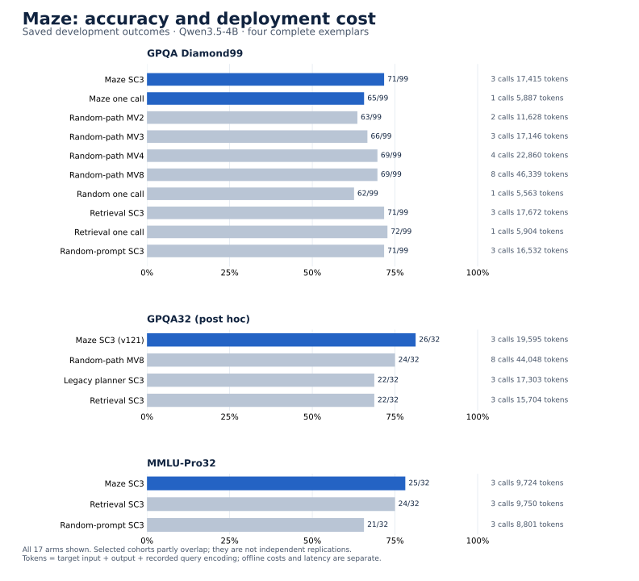

<div align="center">
  
  <p>
    <a href="https://openreview.net/forum?id=e22Krci8Dn"></a>
    <a href="pyproject.toml"></a>
    <a href="LICENSE"></a>
    <a href="CHANGELOG.md"></a>
  </p>
  <p><a href="#the-idea">The idea</a> · <a href="#measured-results">Results</a> · <a href="#start-here">Get started</a> · <a href="docs/USAGE.md">Run Maze</a> · <a href="docs/DEVELOPMENT.md">Build on Maze</a> · <a href="#citation">Cite</a></p>
</div>

**Maze learns which prompt trajectory to execute before asking a language model to reason.**
It ranks complete, ordered exemplar sequences using cached encoder representations and a small geometric scorer, then spends target-model calls on the selected prompts.
The target remains a text-in, text-out model: no target weights, gradients, or hidden states are required.

This is the home of the **Maze project**, spanning the NeurIPS 2026 method, compact scorer variants, inference policies, and reusable experimentation tools.
The library, experiment configurations, and result records are separated so that new models and applications can be added without changing existing experiments.

## The idea

<p align="center"></p>

A prompt is more than an unordered set of relevant examples.
Its content, order, and relation to the query jointly determine the computation it elicits.
Maze makes that ordered path the object of learning:

$$
\widehat P=\arg\max_{P\in\mathcal P(q)}E_\theta(P,q).
$$

The scorer combines **directed transitions**, **node contributions**, and **query-conditioned fusion across encoder views**.
It evaluates candidate inputs, not generated answers.
Bank features are cached, each new query is encoded once, and ranking makes no target-generation calls.

Single-call Maze executes the selected trajectory once.
MultiMaze allocates a fixed budget across selected trajectories, with $\sum_{j=1}^{J}n_j=N$.
Independent-pool winners, shared-pool top-$N$ selection, and repeated decoding of one selected prompt are all supported.
See the [method](docs/METHOD.md) and [scorer configurations](configs/scorers/).

## Results from the NeurIPS 2026 paper

The camera-ready paper reports gains across **five reasoning benchmarks and three open-model families**. The following arithmetic is verified against source-bound excerpts from the author's October 20 camera-ready. These are **paper-reported results**, separate from the development reconstructions below.

| Comparison | Positive model–task cells | Accuracy gain | Target calls, Maze / control |
|---|---:|---:|---:|
| Maze vs random few-shot prompting | **15 / 15** | +3.04 to +15.02 pp | 1 / 1 |
| Maze vs pFLAT | **15 / 15** | +0.99 to +5.88 pp | 1 / 1 |
| Maze vs EASE | **15 / 15** | +1.00 to +5.23 pp | 1 / 1 |
| MultiMaze vs majority vote | **15 / 15** | +1.17 to +16.66 pp | **16 / 32** |

The 15 cells are three targets × five tasks; the rows share cells. The paper also reports matched-pool selection controls, matched-capacity rankers, repeated-run variability, compute accounting, and black-box transfer. Explore the [paper evidence map](docs/PAPER_RESULTS.md), [105 main-table values](results/paper/main_results.csv), and [all 15 source tables](evidence/paper/tables.json).

```bash
# Verify the source transcription and recompute all 60 main-table contrasts.
python scripts/reproduce_paper.py --output runs/paper
```

This verifies the table transcription and arithmetic. Full regeneration of the original benchmark runs requires the original checkpoints, feature bundles, and response archives listed in [asset access](docs/ASSETS.md).

## Measured results

**Nine highlighted positive comparisons, backed by 1,214 saved question-by-policy outcomes and all 21 named-control contrasts.** The included cohorts are GPQA32, GPQA Diamond99, and MMLU-Pro32; GPQA32 supports replay of the underlying votes.

All rows below use **nonthinking Qwen3.5-4B with four complete exemplars**. They are compact development configurations of Maze; their model, scorer, bank, decoding, and repeated-prompt policies differ from the paper's main experiments. These are selected development cohorts across two benchmark families. GPQA32 is a post-hoc cached operating point; the GPQA cohorts partly overlap and are not independent replications. See the [cohort definitions](docs/EXPERIMENTS.md) for selection history and exact membership accounting.

<!-- BEGIN GENERATED DEVELOPMENT HIGHLIGHTS -->
| Cohort | Maze policy | Baseline | Maze accuracy | Baseline accuracy | Gain | Calls | Token ratio |
|---|---|---|---:|---:|---:|---:|---:|
| GPQA Diamond99 | Single-call Maze | Random prompt, 1 call | **65.66%** | 62.63% | +3.03 pp | 1 / 1 | 1.058× |
| GPQA Diamond99 | Single-call Maze | Random-path MV2 | **65.66%** | 63.64% | +2.02 pp | 1 / 2 | 0.506× |
| GPQA Diamond99 | MultiMaze, repeated prompt | Random-path MV3 | **71.72%** | 66.67% | +5.05 pp | 3 / 3 | 1.016× |
| GPQA Diamond99 | MultiMaze, repeated prompt | Random-path MV4 | **71.72%** | 69.70% | +2.02 pp | 3 / 4 | 0.762× |
| GPQA Diamond99 | MultiMaze, repeated prompt | Random-path MV8 | **71.72%** | 69.70% | +2.02 pp | 3 / 8 | 0.376× |
| MMLU-Pro32 | MultiMaze, repeated prompt | Retrieval SC3 | **78.12%** | 75.00% | +3.12 pp | 3 / 3 | 0.997× |
| MMLU-Pro32 | MultiMaze, repeated prompt | Random-prompt SC3 | **78.12%** | 65.62% | +12.50 pp | 3 / 3 | 1.105× |
| GPQA32 (post hoc) | MultiMaze, fixed selected prompt | Retrieval SC3 | **81.25%** | 68.75% | +12.50 pp | 3 / 3 | 1.248× |
| GPQA32 (post hoc) | MultiMaze, fixed selected prompt | Random-path MV8 | **81.25%** | 75.00% | +6.25 pp | 3 / 8 | 0.445× |
<!-- END GENERATED DEVELOPMENT HIGHLIGHTS -->

**Cost scope.** Calls are Maze / comparator. Token ratio is recorded target input + target output + once-per-query encoder processing, including full prompt rereads. A ratio below 1 means fewer tokens in those components; it is not an end-to-end latency, training-cost, or hardware-cost claim. Offline bank processing is reported separately. SC3 repeats one complete prompt in three distinct requests; MV uses separately sampled prompt paths.

**All controls matter.** On GPQA99, retrieval with one call reaches **72/99**, ahead of Maze SC3's **71/99**; random-prompt SC3 and retrieval SC3 also reach 71/99. On GPQA32, Maze's 26/32 versus retrieval's 22/32 costs **24.8% more** recorded tokens; its 26/32 versus MV8's 24/32 uses **55.5% fewer**. These are scoped observations, not universal superiority. All ties, losses, invalid answers, and capped outputs remain in the [complete comparison table](results/reproduced/comparisons.md) and [17-arm ledger](results/reproduced/all_arms.csv).

The [machine-readable report](results/reproduced/summary.json) provides exact fractions, paired wins/losses, and descriptive 95% bootstrap intervals. The cohorts and configurations were selected during development; the intervals are not adjusted for that selection. Positive point differences alone are not significance claims.



### Reproduce the evidence on CPU

From the repository root, using only Python's standard library:

```bash
# Reconstruct every included outcome, control comparison, and cost component.
python scripts/reproduce_results.py --output runs/reproduced

# Check saved tables, README highlights, evidence bindings, and source integrity.
python scripts/verify_release.py
```

The GPQA32 replay verifies **128 votes from 544 call observations representing 487 distinct cached requests**. Reused requests retain the same opaque ID; they are not counted as new physical calls. Opaque answer classes preserve equality and tie order without publishing benchmark questions, answers, or response text.

> Saved-outcome reconstruction checks published numbers. GPQA32 additionally checks voting from already parsed answer classes. Neither independently re-parses or regrades response text, retrains a scorer, nor reruns a target model. **This release makes no new target calls.** See [experiment scope and exposure](docs/EXPERIMENTS.md) and [reproducibility levels](docs/REPRODUCIBILITY.md).

## Start here

Use Python 3.11 or newer.
The evidence commands above need no installation, GPU, API key, or network connection.
For the library and examples:

```bash
git clone https://github.com/sophiapple/Maze.git
cd Maze
python -m venv .venv
source .venv/bin/activate
python -m pip install -e .

# Inspect the workflows and exercise planning, request collection, and grading.
maze --help
maze demo --output runs/demo

# Run the NumPy/reference tests. PyTorch-specific tests need the train extra.
python -m unittest discover -s tests -v
```

The demo uses invented features and a deterministic Python target to illustrate the interfaces; it is not a benchmark experiment.

For differentiable training and numerical checks against the preserved compact scorers:

```bash
python -m pip install -e '.[train]'
maze train-demo --output runs/train-demo
python -m unittest discover -s tests -v
```

The training demo checks gradient updates, checkpoint export, and inference on disjoint synthetic query identities.
[Usage](docs/USAGE.md) covers real data preparation, local-edit supervision, training, prospective planning, API collection, and separate evaluation.

## Method implementations and variants

| Component | What it provides | Entry point |
|---|---|---|
| Scalar-fusion Maze | Directed path energy with coordinate reduction before cross-view nonlinearity | [NumPy](src/maze/scorers/numpy_energy.py), [PyTorch](src/maze/scorers/torch_energy.py), [independent reference](src/maze_paper/scalar_energy.py) |
| Compact vector Maze | Normalized node features, coordinate-preserving fusion, learned scalar readout | [Compact configuration](configs/scorers/compact_vector.json) |
| Full-QA vector Maze | Encoded system and full exemplars, all-view context, interior-view readout | [Full-QA configuration](configs/scorers/fullqa_vector.json) |
| Scorer consensus | Weighted combination of independently fitted input-side energies | [Ensemble](src/maze/scorers/ensemble.py) |
| Residual utility calibration | Query-balanced reference-relative utility fitting | [Calibration](src/maze/calibration.py), [script](scripts/calibrate_residual.py) |
| MultiMaze | Independent pools, top-$N$, repeated prompts, or mixed allocation | [Planner](src/maze/planning.py), [policy configurations](configs/policies/) |
| Archived compact recipes | Original success, reference-relative, auxiliary-loss and replay definitions | [Compact reproduction](reproduction/compact/) |

The generic trainer fits success and ranking objectives.
The preserved compact recipes also expose the auxiliary objectives used by their original configurations.
Implementations are checked for numerical consistency; the measured results above retain their own experiment identities rather than being attributed to every variant.

## A project built to extend

```text
src/maze/                  Reusable planning, scorers, training, and model adapters
src/maze_paper/            Independent equation and policy references
configs/                   Scorer, allocation, and experiment definitions
scripts/                   Reproduction, data preparation, calibration, and audits
evidence/development/      Complete selected-cohort outcomes, vote records, and provenance
evidence/paper/            Source-bound camera-ready table excerpts and transcription
results/reproduced/        Reconstructed tables and statistics
reproduction/compact/      Preserved compact-scorer replay implementations
docs/                      Method, usage, experiment, and extension guides
tests/                     Numerical, data-separation, accounting, and workflow tests
```

Encoders produce a `FeatureStore`; scorers rank complete paths; allocation policies schedule requests; targets return a `Generation`.
These boundaries allow new backbones, banks, scorers, and deployment settings without coupling them to a single paper or provider.
[Development](docs/DEVELOPMENT.md) explains the extension contracts and experiment-registration process.

## Citation

**Geometric Prompt-Trajectory Planning for Test-Time Scaling**  
Zhengqi Pei, Anran Zhang, Qingming Huang, and Shuhui Wang. NeurIPS 2026.

```bibtex
@inproceedings{pei2026maze,
  title     = {Geometric Prompt-Trajectory Planning for Test-Time Scaling},
  author    = {Pei, Zhengqi and Zhang, Anran and Huang, Qingming and Wang, Shuhui},
  booktitle = {Advances in Neural Information Processing Systems},
  year      = {2026},
  url       = {https://openreview.net/forum?id=e22Krci8Dn}
}
```

Machine-readable citation metadata is in [CITATION.cff](CITATION.cff).

## License and contributions

Maze code is distributed under the [MIT license](LICENSE).
Models, benchmark data, and externally supplied trained assets retain their own terms; see [asset access](docs/ASSETS.md) and [third-party notices](THIRD_PARTY_NOTICES.md).
The public evidence contains numeric records, not benchmark question text or raw model responses.

Contributions that add a well-defined experiment, a model adapter, or a tested scorer are welcome.
Start with [CONTRIBUTING.md](CONTRIBUTING.md).
